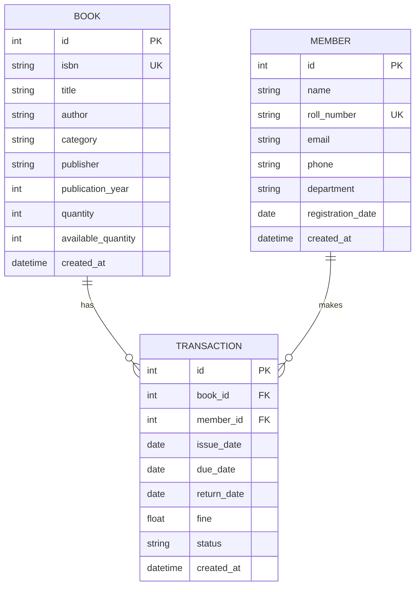

# 📚 College Library Management System

A full-stack, production-grade **Library Management System** built with **FastAPI**, **SQLAlchemy**, **SQLite**, and **HTML5/CSS3/Vanilla JavaScript**. Designed specifically for college academic environments and field activity project presentations.

---

## 🌟 Key Features

### 📖 1. Catalog & Book Inventory Management
- Full CRUD operations (Add, View, Edit, Delete books).
- Tracks both **Total Copies** and **Available Copies** dynamically.
- Live search by **Title**, **Author**, **ISBN**, or **Publisher**.
- Category filtering (*Programming, Computer Science, Mathematics, Physics, Literature, History, Other*).
- **Integrity protection**: Prevents negative stock and blocks deleting books with active issued copies.

### 👥 2. Student & Patron Membership Directory
- Register and manage students and faculty with unique **Roll Numbers / IDs**.
- Department filtering and multi-field live search.
- **Member Detail Profile**: View individual borrowing history, active loans, and overdue status.
- **Integrity protection**: Enforces unique roll numbers and blocks deleting members with active loans.

### 📤 3. Book Issuing (Circulation Desk)
- Seamless checkout workflow with interactive patron and book selectors.
- Live stock availability verification (prevents issuing out-of-stock titles).
- Automatically sets standard **14-day loan period** with manual date override support.
- Immediate inventory decrement upon issue.

### 📥 4. Book Return & Fine Settlement
- Fast lookup of active loans by **Transaction ID**, **Student Name**, **Roll Number**, or **Book Title**.
- **Dynamic Fine Calculator**: Automatically assesses overdue fines at **₹5 per day** based on actual return date.
- Real-time fine breakdown preview before confirming check-in.
- Automatic inventory replenishment upon return.

### 📑 5. Transaction Audit Log & Overdue Tracking
- Comprehensive audit trail of all circulation activities.
- Status filters: **All**, **Active (Issued)**, **Completed (Returned)**, and **Overdue Loans**.
- Dedicated Overdue tracking view with days-late calculation and direct return shortcuts.

### 📊 6. Analytics Dashboard
- Dynamic real-time metrics:
  - **Total Books & Copies**
  - **Available Books on Shelves**
  - **Issued Books on Loan**
  - **Registered Patrons**
  - **Overdue Books Count**
  - **Total Fines Collected & Pending**
- Quick action navigation cards.
- Live category distribution breakdown and recent circulation activity stream.

---

## 🛠️ Technology Stack

| Layer | Technology | Description |
|---|---|---|
| **Frontend** | HTML5, CSS3, Vanilla JavaScript | Responsive modern UI with custom design system, zero external heavyweight frameworks |
| **Backend** | Python 3.10+, FastAPI | High-performance asynchronous RESTful API architecture |
| **Data Validation** | Pydantic v2 | Strict request/response validation and serialization |
| **ORM** | SQLAlchemy 2.0 | Relational database mapping, constraints, and relationships |
| **Database** | SQLite3 | Persistent file-based relational storage with auto-migration and bootstrap seeding |
| **Server** | Uvicorn | High-performance ASGI web server |

---

## 🗄️ Database Design



---

## 📁 Project Structure

```
library-management-system/
├── backend/
│   ├── main.py              # FastAPI application, static mounting & route definitions
│   ├── database.py          # SQLAlchemy SQLite connection and session maker
│   ├── models.py            # Relational database models (Book, Member, Transaction)
│   ├── schemas.py           # Pydantic schemas for data validation and responses
│   ├── crud.py              # Core business logic and database queries
│   ├── seed_data.py         # Initial sample data seeder for immediate demonstration
│   ├── requirements.txt     # Backend Python dependencies
│   └── library.db           # SQLite database file (created automatically)
├── frontend/
│   ├── index.html           # Analytics Dashboard
│   ├── books.html           # Book Inventory Catalog
│   ├── members.html         # Student/Patron Directory
│   ├── issue.html           # Issue Book Checkout Desk
│   ├── return.html          # Return Book & Fine Calculator Desk
│   ├── transactions.html    # Transactions Log & Overdue Tracker
│   ├── css/
│   │   └── style.css        # Clean responsive design system
│   └── js/
│       ├── api.js           # Shared Fetch API wrapper, toasts & formatting
│       ├── dashboard.js     # Dashboard metrics loader
│       ├── books.js         # Book CRUD logic & modals
│       ├── members.js       # Member CRUD logic & profile modal
│       ├── issue.js         # Book checkout workflow
│       ├── return.js        # Return check-in & live fine calculator
│       └── transactions.js  # Transaction listing & filters
└── README.md                # Project documentation & presentation guide
```

---

## 🚀 Quick Start & Installation (Ubuntu / Linux)

### 1. Clone or Navigate to Project Directory
```bash
cd /home/alarion/.gemini/antigravity/scratch/library-management-system
```

### 2. Set Up Virtual Environment & Install Dependencies
```bash
# Navigate to backend directory
cd backend

# Create virtual environment
python3 -m venv venv

# Activate virtual environment
source venv/bin/activate

# Install required packages
pip install -r requirements.txt
```

### 3. Launch the Complete Full-Stack Application
```bash
# Start FastAPI application (from the backend directory)
uvicorn main:app --reload --host 127.0.0.1 --port 8000
```

### 4. Access the Application
Open your web browser and navigate to:
- **Web Application UI**: [http://127.0.0.1:8000](http://127.0.0.1:8000)
- **Interactive Swagger API Docs**: [http://127.0.0.1:8000/docs](http://127.0.0.1:8000/docs)
- **Alternative ReDoc API Docs**: [http://127.0.0.1:8000/redoc](http://127.0.0.1:8000/redoc)

> **Note**: FastAPI automatically mounts and serves the frontend static files at `http://127.0.0.1:8000`. You do not need to run a separate web server for the frontend!

---

## 🔄 Core Circulation Workflow

```
[ Catalog Book ] ──> [ Register Member ] ──> [ Issue Book (14-day loan) ]
                                                        │
                                                        ▼
[ Calculate Fine (₹5/day) ] <── [ Overdue Detection ] <── [ Active Loan Period ]
           │
           ▼
[ Return Book & Restore Stock ] ──> [ Update Dashboard Statistics ]
```

1. **Add Book**: Add a book title with quantity (e.g., 5 copies). Available copies is initialized to 5.
2. **Register Member**: Register student with name, roll number, and department.
3. **Issue Book**: Select student and book. Available copies decrements to 4. Due date is set (default +14 days).
4. **Track Status**: Dashboard and Transactions table track active and overdue loans.
5. **Return Book**: On return, fine is calculated (`overdue_days × ₹5`). Available copies increments back to 5.

---

## 📡 API Reference Overview

### Dashboard
- `GET /api/dashboard/stats` - Retrieve aggregate statistics and recent transactions.

### Books
- `GET /api/books` - List all books (supports `search` and `category` filters).
- `GET /api/books/{id}` - Get book details.
- `POST /api/books` - Add a new book.
- `PUT /api/books/{id}` - Update book details or stock quantity.
- `DELETE /api/books/{id}` - Delete a book (blocked if active copies are issued).

### Members
- `GET /api/members` - List all members (supports `search` and `department` filters).
- `GET /api/members/{id}` - Get member profile and loan history.
- `POST /api/members` - Register a new member.
- `PUT /api/members/{id}` - Update member profile.
- `DELETE /api/members/{id}` - Delete a member (blocked if active loans exist).

### Transactions
- `GET /api/transactions` - List circulation transactions (supports `status` and `search` filters).
- `POST /api/transactions/issue` - Issue a book copy to a member.
- `PUT /api/transactions/{id}/return` - Return a book and settle fines.
